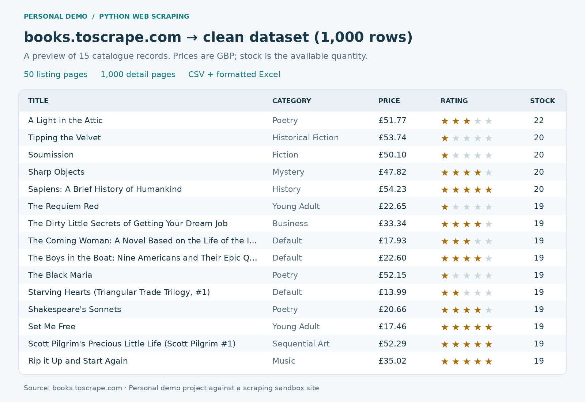
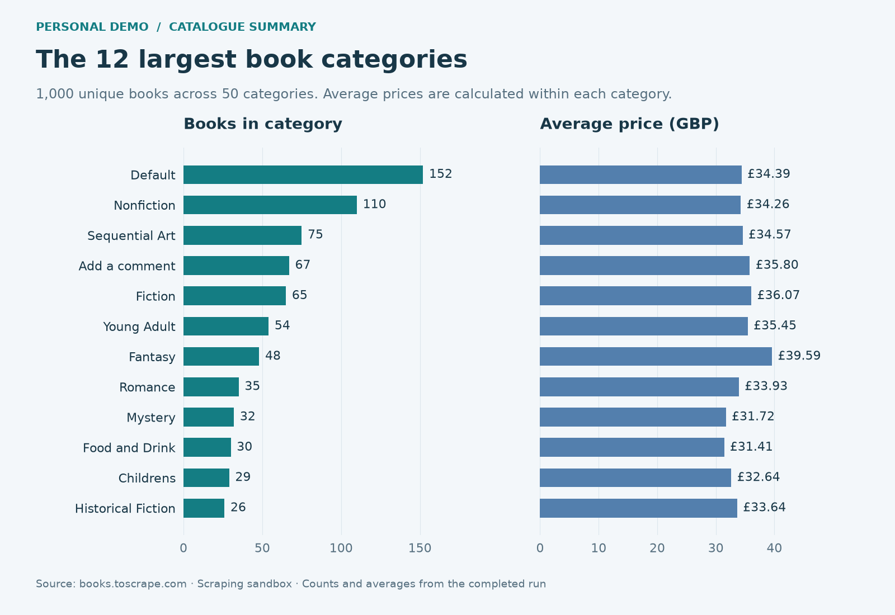
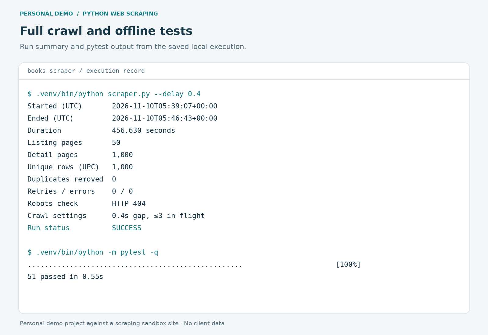

# Books to Scrape: polite scraper and clean data exports

> **Personal demo project (not client work).** Built by Zhuangyi Qiu as an Upwork portfolio sample.
>
> **Stack:** Python 3, httpx, BeautifulSoup4, openpyxl, matplotlib, pytest
> **Tests:** `.venv/bin/python -m pytest -q` (51 passed, offline fixtures)
> **License:** MIT

This is a **personal demo project against a scraping sandbox site**, built as an
Upwork portfolio sample for Python web scraping and automation. It uses the public
[Books to Scrape sandbox](https://books.toscrape.com/). The site's prices and
ratings are demonstration data, not real retail observations.

The scraper follows the catalogue's **next** links until pagination ends, then
visits every linked product detail page. It extracts and validates 15 fields,
deduplicates by UPC, and produces a UTF-8 CSV, a formatted Excel workbook, and
execution evidence. No paid services, accounts or API keys are required.

## Setup and run

Run these commands inside this project folder:

```sh
python3 -m venv .venv
.venv/bin/python -m pip install -r requirements.txt
.venv/bin/python scraper.py --delay 0.4 --out-dir output
.venv/bin/python -m pytest -q > output/pytest.txt 2>&1
.venv/bin/python scripts/build_portfolio.py
.venv/bin/python scripts/verify_outputs.py
```

The delivered run used **CPython 3.15.0** on macOS ARM64. All dependencies installed
successfully, so a fallback interpreter was unnecessary. `requirements.txt`
declares compatible ranges; `requirements-lock.txt` records the exact installed
versions. To reproduce that environment, install `-r requirements-lock.txt` instead.

For a shorter preview, use a separate output folder so the full dataset remains
available:

```sh
.venv/bin/python scraper.py --max-pages 2 --delay 0.5 --out-dir output-preview
```

CLI options:

| Option | Default | Meaning |
| --- | --- | --- |
| `--max-pages` | All | Maximum number of listing pages, a positive integer. Detail pages for those listings are still fetched. |
| `--delay` | `0.4` | Minimum seconds between request starts, a finite nonnegative number. |
| `--out-dir` | `output` | Destination for data, logs, robots evidence and run summary. |

`scripts/build_portfolio.py` accepts `--out-dir` and `--image-dir`. The delivery
verification script intentionally checks the full 50-page, 1,000-book dataset.
Tests run offline using saved HTML and mocked HTTP responses. Temporary test and
matplotlib cache files stay inside this project folder.

## robots.txt and request policy

Before fetching any catalogue HTML, the initial check of
<https://books.toscrape.com/robots.txt> returned **HTTP 404 Not Found** on
2026-11-10 UTC. The response was a short nginx HTML error page. The scraper checks
again at the start of each run and saves the actual response and headers to
`output/robots.txt` and `output/robots_headers.txt`. A missing robots file publishes
no crawl directives; it is not a blanket permission claim for other websites.

- User-Agent: `BooksScraperPortfolio/1.0 (personal sandbox demo)`.
- At most **3 requests in flight**, with a **shared 0.4-second gap between request
  starts** by default. The same gate applies to listing pages, detail pages,
  robots checks and retries. A published robots crawl delay increases that gap.
- Explicit 30-second request timeout and 15-second connection timeout.
- Up to 3 retries after the initial attempt for transport errors, timeouts, 5xx
  responses and HTTP 429, with exponential backoff of 1, 2 and 4 seconds. A numeric
  `Retry-After` header can increase the wait. Ordinary 4xx responses are not retried.
- Same-origin HTTPS links only, no automatic redirects, and robots rules are
  checked before catalogue requests. Robots access failures stop the run.
- No login, anti-bot bypass, proxy rotation, image downloading or category-page
  crawling. Only catalogue listings and their product details are fetched.

The run log reports progress, UTC start/end timestamps, listing/detail counts,
unique rows, removed duplicates, retries, errors and elapsed time. Errors produce
a nonzero exit code. A detail-page failure can leave partial exports for diagnosis;
the summary records a failed status and image generation refuses failed runs.

## Output schema

CSV columns retain this order. Money is stored as numeric GBP values without a
currency symbol. Excel keeps numeric cells numeric and UPCs as text, preserving
leading zeroes. `scraped_at` is ISO 8601 text in both exports to preserve its UTC
offset explicitly.

| Field | Python type | Source / cleaning |
| --- | --- | --- |
| `title` | `str` | Full detail-page heading; whitespace normalized. |
| `category` | `str` | Category breadcrumb immediately before the title. |
| `price_gbp` | `float` | Displayed GBP price, parsed to two-decimal precision. |
| `availability_count` | `int` | Count from `In stock (N available)`; explicit out-of-stock becomes 0. |
| `rating` | `int` | Star CSS class mapped to 1–5. |
| `upc` | `str` | Product-information UPC; deduplication key. |
| `product_type` | `str` | Product-information type. |
| `price_excl_tax` | `float` | Product-information price excluding tax (GBP). |
| `price_incl_tax` | `float` | Product-information price including tax (GBP). |
| `tax` | `float` | Product-information tax (GBP). |
| `num_reviews` | `int` | Product-information review count. |
| `description` | `str` | Plain description text with whitespace normalized; empty if absent. |
| `image_url` | `str` | Absolute HTTPS image URL resolved against the detail page. |
| `product_url` | `str` | Absolute HTTPS detail-page URL. |
| `scraped_at` | `str` | Detail extraction time in UTC, e.g. `2026-11-10T05:00:00+00:00`. |

Required fields, numeric types, finite nonnegative money values, stock/review
counts, rating range, URL origins and UTC timestamps are validated. Displayed
price must equal inclusive price, and excluding price plus tax must reconcile.
Malformed required values fail explicitly. Optional descriptions are not invented,
and source wording is retained even when the sandbox itself repeats text.

## Files and workbook

- `scraper.py`: reusable command-line scraper, parsers, validation and exports.
- `output/books.csv`: UTF-8 data in catalogue order after UPC deduplication.
- `output/books.xlsx`: `Books` sheet with bold headers, frozen row 1, autofilter,
  alternating row fills, column widths and GBP formats. The second sheet,
  `Summary`, contains each category's book count, average price and average rating.
  Summary values are snapshots of this export; rerun the scraper to refresh them.
  Long titles/descriptions remain complete in the cell; widen the column or use
  the formula bar to read them in Excel.
- `output/run_log.txt`: human-readable real execution log.
- `output/run_summary.json`: machine-readable run metrics and error list.
- `output/robots.txt`, `output/robots_headers.txt`: observed robots response.
- `output/pytest.txt`: actual final pytest output.
- `output/verification.json`: independent CSV/XLSX/summary/image checks and SHA-256
  hashes of the deliverables and HTML fixtures.
- `tests/fixtures/`: one raw listing page and one raw detail page with provenance.
- `tests/test_parse.py`: fixture-based parsing and validation tests.
- `tests/test_client.py`: robots, retry, request-spacing and concurrency tests.
- `tests/test_exports.py`: data types, identifiers and workbook-feature checks.
- `scripts/build_portfolio.py`: creates the three 1600 × 1100 light-theme PNGs
  below from the actual run, exported rows and saved pytest output.
- `scripts/verify_outputs.py`: independently verifies the complete delivery.
- `requirements.txt`, `requirements-lock.txt`: dependency ranges and run snapshot.

## Portfolio images







## Verified full run and first five rows

The delivered run followed pagination to the end and fetched **50 listing pages
and 1,000 detail pages**, producing **1,000 unique UPCs**. It ran from
`2026-11-10T05:39:07+00:00` to `2026-11-10T05:46:43+00:00`, taking
**456.630 seconds** (7 minutes 36.630 seconds). It removed **0 duplicates** and
recorded **0 retries and 0 errors**. The final offline suite reported
**51 passed in 0.55s** in `output/pytest.txt`.

The dataset contains **50 categories**. Two detail pages have no description, so
their description cells are empty. Sandbox category labels such as `Default` and
`Add a comment` are preserved as published. Independent checks compare all 15,000
exported field values and all category aggregates; see `output/verification.json`.

Selected columns from the first five CSV records, in catalogue order:

| Title | Category | Price (GBP) | Rating | Stock | UPC |
| --- | --- | ---: | ---: | ---: | --- |
| A Light in the Attic | Poetry | 51.77 | 3 | 22 | a897fe39b1053632 |
| Tipping the Velvet | Historical Fiction | 53.74 | 1 | 20 | 90fa61229261140a |
| Soumission | Fiction | 50.10 | 1 | 20 | 6957f44c3847a760 |
| Sharp Objects | Mystery | 47.82 | 4 | 20 | e00eb4fd7b871a48 |
| Sapiens: A Brief History of Humankind | History | 54.23 | 5 | 20 | 4165285e1663650f |
